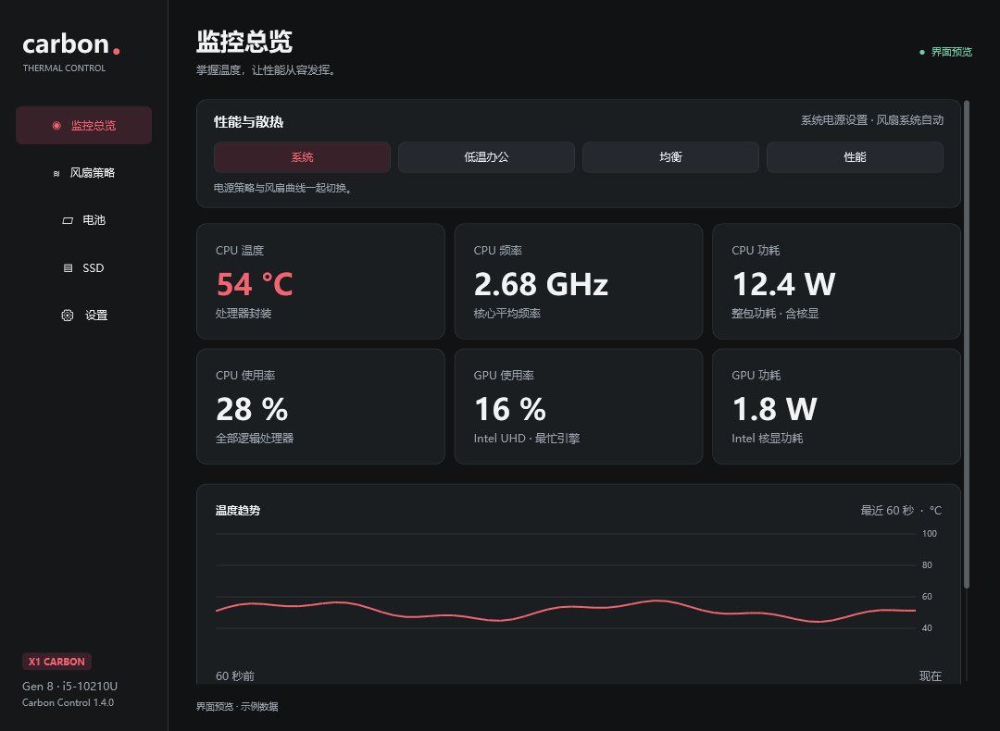
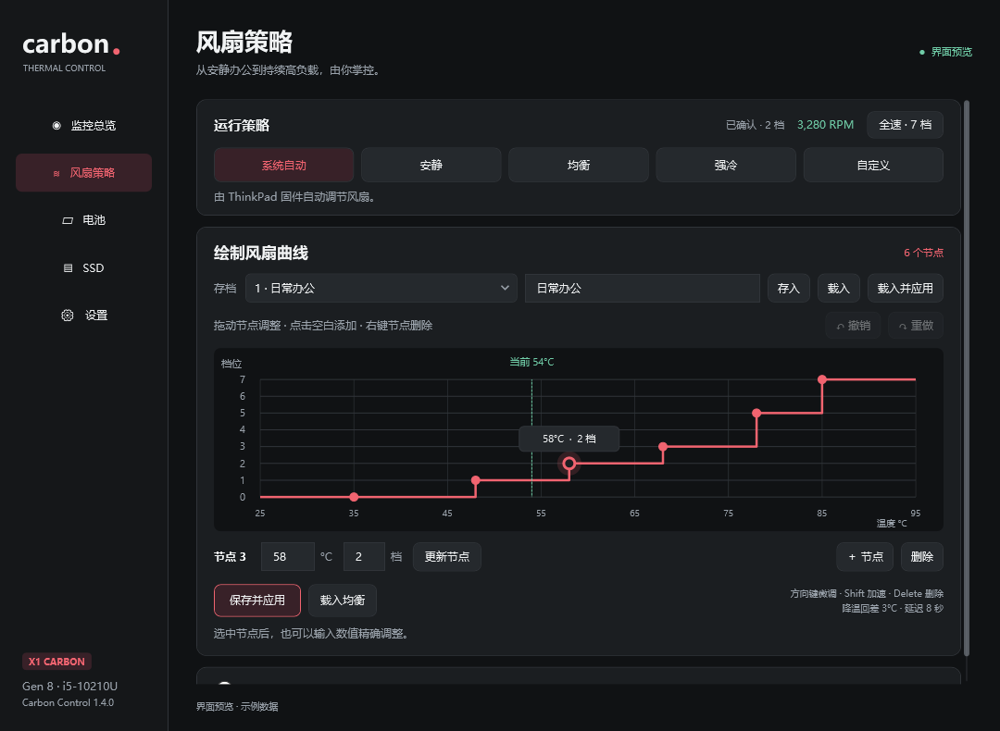
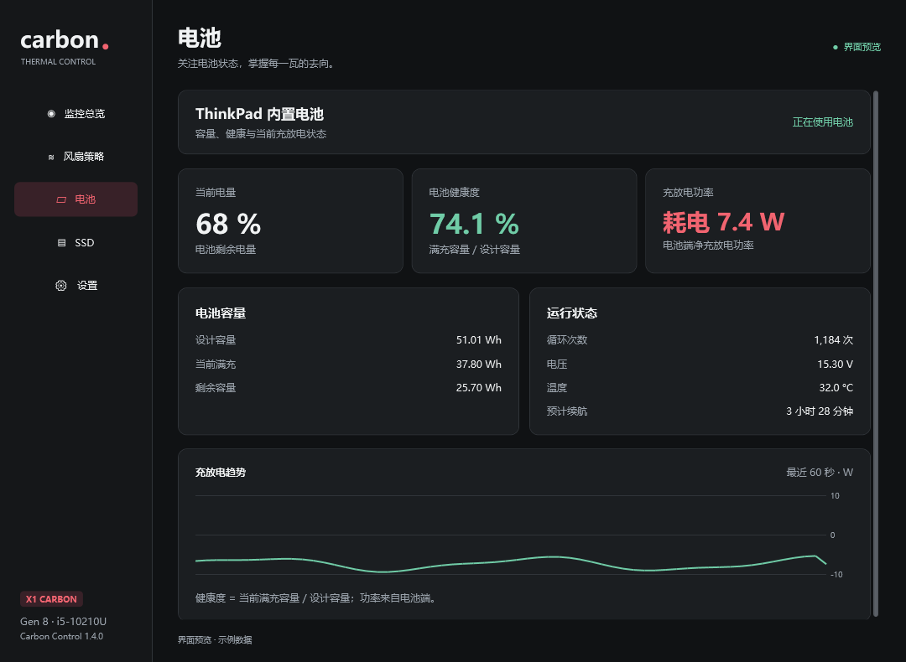
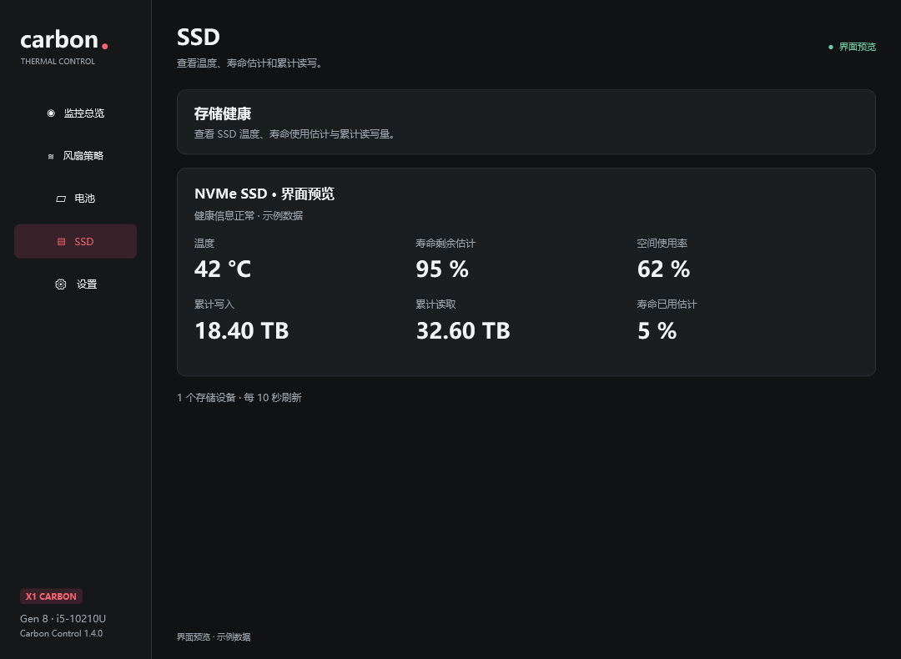

# ThinkPad X1 Carbon Tool · Carbon Control

面向 **ThinkPad X1 Carbon Gen 8 / i5-10210U、i5-10310U** 的 Windows 温度监测与风扇管理工具。原生 WPF 界面，支持 Windows 10/11 x64、.NET Framework 4.8。

[下载最新版本](https://github.com/NanNan-meow/ThinkPadX1CarbonTool/releases/latest) · [查看更新记录](docs/RELEASE-v1.4.0.md)



## 使用

1. 从 Releases 下载 `CarbonControl-v1.4.0-win-x64.zip`，解压整个目录，打开 `CarbonControl.exe`。
2. 首次进入 **设置 → 配置硬件组件**，安装 LibreHardwareMonitor 0.9.6 与 PawnIO 2.2.0 官方组件。下载文件会校验 SHA-256。
3. 组件检查通过后，应用会自动重启并返回设置页，加载最新的硬件组件和配置；也可点击 **管理员模式** 启动。
4. 进入 **风扇策略**，选择预设，或直接拖动曲线节点后点击 **保存并应用**。

更新版本前，从托盘菜单退出旧版。用户设置保存在 `%LOCALAPPDATA%\CarbonControl`，更新时会继续使用；已保存的旧自定义曲线会迁移到第一个存档槽。

Release 包提供主程序和组件配置入口，硬件组件在首次配置时从官方来源下载。

## 功能

- 每秒刷新 CPU 温度、核心平均频率、整包功耗、使用率，以及 Intel 核显使用率和功耗。
- 最近 60 秒温度趋势、风扇 RPM 与档位确认状态。
- 电池健康度、循环次数、充放电功率和 60 秒功率趋势，以及容量、电压和预计续航。
- SSD 温度、寿命剩余估计、累计读写与空间使用率，支持多个存储设备。
- 低温办公、均衡、性能电源模式，与风扇曲线一起应用；退出时恢复原电源方案。
- 系统自动、安静、均衡、强冷、自定义曲线和手动 0–7 档。
- 拖动节点绘制曲线，支持 2–12 个节点、点击添加、右键删除、数值编辑与撤销/重做。
- 三个可命名曲线存档，支持保存、覆盖、载入及直接应用。
- **全速 · 7 档**快捷按钮，再次点击返回原策略或原手动档位；监控页、风扇页与托盘均可操作。
- 单例运行、托盘驻留、开机登录启动、Dark / Light / 跟随系统。
- 打开应用并连接成功后自动应用所选风扇策略，支持预设与三个命名存档，默认均衡。
- 导出硬件检测报告。



[查看浅色界面](docs/images/fan-light.png)

## 电池、SSD 与性能模式

电池页面每 2 秒更新，健康度取满充容量与设计容量的比值，循环次数从 Windows 电池报告补充。充放电功率表示电池端净功率，连接电源时会显示充电功率。电池报告在本地缓存，每 6 小时刷新一次。

SSD 页面每 10 秒更新，显示各设备温度、寿命剩余估计、累计读写和空间使用率。寿命来自 SSD 提供的磨损数据，与剩余磁盘空间分开显示。设备没有提供的字段显示 `—`。电池和存储采样在独立线程运行。



总览上的四个按钮同时选择电源模式和风扇策略：

| 模式 | 处理器睿频 | 风扇策略 |
| --- | --- | --- |
| 系统 | 恢复原电源方案 | 系统自动 |
| 低温办公 | 关闭睿频 | 均衡曲线 |
| 均衡 | 允许睿频 | 均衡曲线 |
| 性能 | 请求积极睿频 | 强冷曲线 |

电源设置分别应用到接电和电池状态，使用从当前方案复制的独立方案，读回确认后切换。实际频率由处理器和固件调节。风扇连接成功后应用联动曲线，之后仍可手动切换风扇策略。切回系统或正常退出时恢复原方案；异常退出会在下次启动时恢复，期间在 Windows 中手动选择的其他方案会继续保留。



## 绘制与保存曲线

拖动节点：左右调温度，上下调档位；点击空白处添加节点，右键节点删除。选中节点后也可输入数值并按 Enter。方向键微调，Shift + 左右键每次调整 5°C，Delete 删除，Ctrl+Z / Ctrl+Y 撤销和重做。

选中存档槽位，输入名字，点击 **存入**；再次存入会覆盖该槽位。**载入**恢复到编辑区，**载入并应用**直接启用。绿色虚线表示当前 CPU 温度。

在「设置 → 启动与托盘 → 启动风扇策略」选择默认策略。程序等温度读数新鲜有效、风扇接口连接确认后自动启用，每次启动只执行一次；之后手动切换不会被覆盖。启动策略可以使用系统自动、安静、均衡、强冷、当前自定义曲线或已有存档，空存档不可选。

风扇使用 0–7 档：0 档停转，7 档为最高普通档位；每档实际 RPM 取决于固件。节点保持温度有序与档位递增，最后一个节点在 90°C 以内达到 7 档。升温立即升档，降温使用 3°C 回差与 8 秒延迟。

## 风扇通信

CPU 监控和曲线判断每秒运行；风扇模式和 RPM 每 5 秒合并回读一次，同档位每 15 秒保活。切换策略、手动改档和应用新曲线会立即唤醒控制线程，下发后读回寄存器确认。

EC 通信使用有界重试与退避，并兼容部分固件的 IBF 清除读取方式。单次遥测超时保留已确认的设置，连续三次失败恢复系统自动。温度数据超过 5 秒未更新、正常退出或休眠时恢复自动；另有独立守护进程处理主进程退出或停止心跳。

实现参考 [TPFanCtrl2 的 Cycle=5 配置](https://raw.githubusercontent.com/Shuzhengz/TPFanCtrl2/main/fancontrol/TPFanControl.ini)、[TPFanCtrl2 EC 协议](https://raw.githubusercontent.com/Shuzhengz/TPFanCtrl2/main/fancontrol/portio.cpp) 和 [LibreHardwareMonitor EC 实现](https://raw.githubusercontent.com/LibreHardwareMonitor/LibreHardwareMonitor/v0.9.6/LibreHardwareMonitorLib/Hardware/Motherboard/Lpc/EC/WindowsEmbeddedControllerIO.cs)。

## 监控口径与适配

CPU 功耗读取 CPU Package，包含核显部分；GPU 功耗读取 Intel 图形域。两者不直接相加。GPU 使用率取最忙的 Intel GPU 引擎。频率优先显示核心平均读数，硬件库未连接时使用 Windows 处理器频率；缺少读数时显示 `—`。

风扇控制仅在 Lenovo 机型代码 **20U9 / 20UA** 且 CPU 为 **i5-10210U / i5-10310U** 时启用。开机启动使用当前用户的计划任务，在管理员模式下设置。正常运行只有一个主程序托盘；启用控制时还会有一个不带托盘的守护进程。

## 构建与验证

使用 Windows 自带 .NET Framework C# 编译器，无需额外 .NET SDK：

```powershell
powershell -NoProfile -ExecutionPolicy Bypass -File .\build.ps1 -Test -Preview
```

输出为 `dist\CarbonControl-v1.4\CarbonControl.exe`。测试报告为 `test-results.txt` 和 `ui-test-results.txt`，示例界面截图位于 `previews`。

```powershell
powershell -NoProfile -ExecutionPolicy Bypass -File .\scripts\package-release.ps1 -Version 1.4.0
```

发布包及 SHA-256 校验文件输出到 `release`。GitHub Actions 在推送 `v*` 标签时构建、运行测试并创建 Release。

新版正式 Release 的程序包与校验文件验证成功后，会自动删除更早的正式 Release，下载页保留最新版本。

672 项逻辑断言及界面交互检查覆盖组件加载、启动策略、风扇通信、电池与 SSD 字段映射、电源模式应用与恢复。协议和电源切换测试使用模拟后端，截图使用示例数据。

源码位于 `src`，构建脚本为 `build.ps1`，硬件配置脚本为 `scripts/setup-hardware.ps1`。

## 第三方组件

- [LibreHardwareMonitor 0.9.6](https://github.com/LibreHardwareMonitor/LibreHardwareMonitor/releases/tag/v0.9.6)
- [PawnIO 官方驱动](https://pawnio.eu/)
- [Lenovo X1 Carbon Gen 8 设备资料](https://pcsupport.lenovo.com/us/en/products/laptops-and-netbooks/thinkpad-x-series-laptops/thinkpad-x1-carbon-8th-gen-type-20u9-20ua/20ua)

组件来源和许可证见 [THIRD-PARTY-NOTICES.txt](THIRD-PARTY-NOTICES.txt)。
